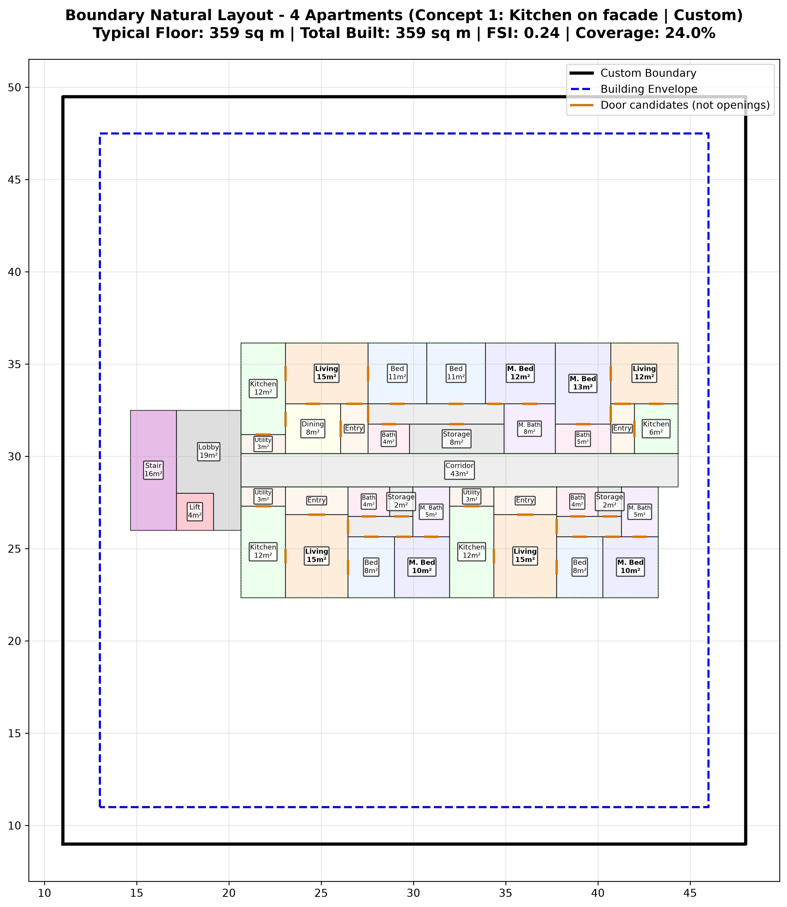
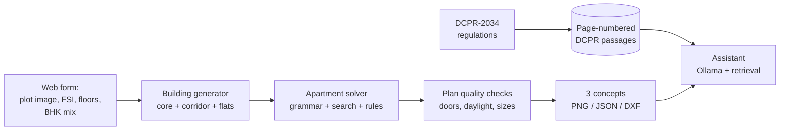

# Floor-Plan Concept Generator for Mumbai Plots

Upload a plot boundary, choose how many 1/2/3/4 BHK flats you want per floor, and get
**three alternative floor-plan concepts** as PNG, JSON and AutoCAD-ready **DXF**. The concepts
include a lift and staircase core and a common corridor. An assistant grounded in the
**Mumbai DCPR-2034** regulations answers questions about the rules and about your plan.

No training data is needed. Layouts come from an architectural grammar plus an exhaustive
search scored by design rules. The assistant runs on a **local LLM (Ollama)**, so nothing
leaves the machine.


> 🥉 **3rd Place, Best College Project**: capstone at MPSTME, SVKM's NMIMS (2026)

<p align="center">
  
  <br/><sub>A generated typical floor: four flats (2, 2, 3 and 1 BHK) around a common corridor, with stair, lift and lobby.</sub>
</p>

---

## How it fits together



| Folder | What it is |
|---|---|
| [`CompleteBackend/`](CompleteBackend) | Building generator, apartment solver (`apartment_solver.py`), plan checks (`plan_quality.py`), DXF export |
| [`backend-flask/`](backend-flask) | Flask web app, user accounts, results pages, DCPR assistant (`llm_chat.py`) |
| [`backend-flask/dcpr_parser/`](backend-flask/dcpr_parser) | DCPR-2034 text split into 1,434 page-numbered passages |

---

## Quick start

```bash
git clone https://github.com/Thanush-RajuKaneshan/floor-plan-generator.git
cd floor-plan-generator

python -m venv .venv && source .venv/bin/activate      # Windows: .venv\Scripts\activate
pip install -r backend-flask/requirements.txt

cd backend-flask
python app.py                                           # http://127.0.0.1:5000
```

Register an account, fill in the plot form, upload the plot image, and open the result page. Use
the concept buttons to switch between the three layouts. Each result can be downloaded as DXF.

### Turn on the AI assistant (optional)

The app works without it. Questions then get rule-based glossary answers.

```bash
# install Ollama from https://ollama.com, then:
ollama pull qwen2.5:7b
ollama serve
```

| Variable | Default | Purpose |
|---|---|---|
| `OLLAMA_URL` | `http://localhost:11434` | Ollama server |
| `OLLAMA_MODEL` | `qwen2.5:7b` | Any chat model you have pulled |
| `SECRET_KEY` | random per start | Flask session key; set it so logins survive restarts |

---

## How the generator works

1. **Building envelope.** The red plot boundary is read from the image. The setback buildable
   area is computed and a lift and staircase core is placed with a common corridor.
2. **Flat depth.** Each row's depth is derived from how much facade its rooms need. The flats
   are deepened in 0.5 m steps until the building fits the plot.
3. **Apartment solver** (`CompleteBackend/apartment_solver.py`). Every flat is built from a grammar
   that is logical by construction:
   *entrance off the corridor → living → passage → bedrooms on the facade*, with the master bath
   beside the master bedroom and the kitchen beside the living room with a utility.
   The solver enumerates kitchen position × mirroring × band depths and scores each candidate
   with itemised penalties: area targets, minimum widths, proportions, daylight on habitable
   rooms and door access. It keeps the three best *distinct* arrangements as the concepts.
   This takes about 60 ms per flat.
4. **Quality checks** (`plan_quality.py`). Doors are drawn only between sensible room pairs.
   Every room is checked for reachability and an outside wall. A kitchen can borrow light
   through its utility, and dining through living.
5. **Export.** Each concept is saved as PNG, JSON (with each flat's arrangement and design
   issues) and DXF.

If a flat cannot be laid out sensibly, the app says which rule failed (for example, *"Apartment 3
(3 BHK, 6.1 m x 8.0 m) cannot be laid out: …"*) instead of producing a broken plan.

## How the assistant works

`backend-flask/llm_chat.py` retrieves the most relevant passages from 1,434 page-numbered
DCPR-2034 chunks using BM25. It sends them to the local model together with the facts of the
user's latest plan. Answers cite pages as `[p.N]` and never claim a plan is approved.
The **AI review** button on a result uses the same model to suggest at most three design
improvements.

---

## Tests

```bash
(cd CompleteBackend && python -m unittest discover -s tests)    # generator: 18 tests
(cd backend-flask && python -m unittest discover -s tests)      # app + assistant: 13 tests
```

## Roadmap

- [ ] Replace BM25 with `nomic-embed-text` embeddings over the page-numbered DCPR chunks
- [ ] Accept a plain-English brief ("two 2BHKs and a 3BHK…") that fills the BHK form, using LLM tool calls
- [ ] Support extra rooms from the brief (study, walk-in closet) and balconies in the solver

## Limitations

Generated plans are **early schematic concepts**, not approved drawings. A licensed architect must
check them against DCPR-2034 and site conditions.

## Author

**Thanush Raju Kaneshan**: [LinkedIn](https://www.linkedin.com/in/thanush-raju-kaneshan/) · [GitHub](https://github.com/Thanush-RajuKaneshan)

Built as a team capstone project at MPSTME, SVKM's NMIMS. This repository holds the
floor-plan generator and web app.
